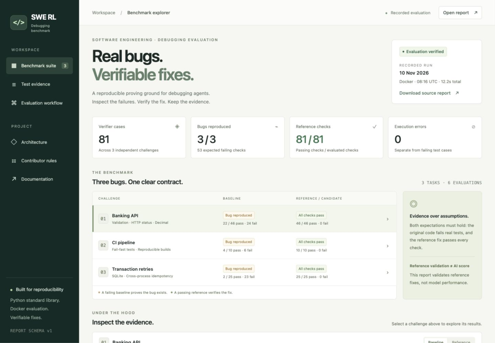
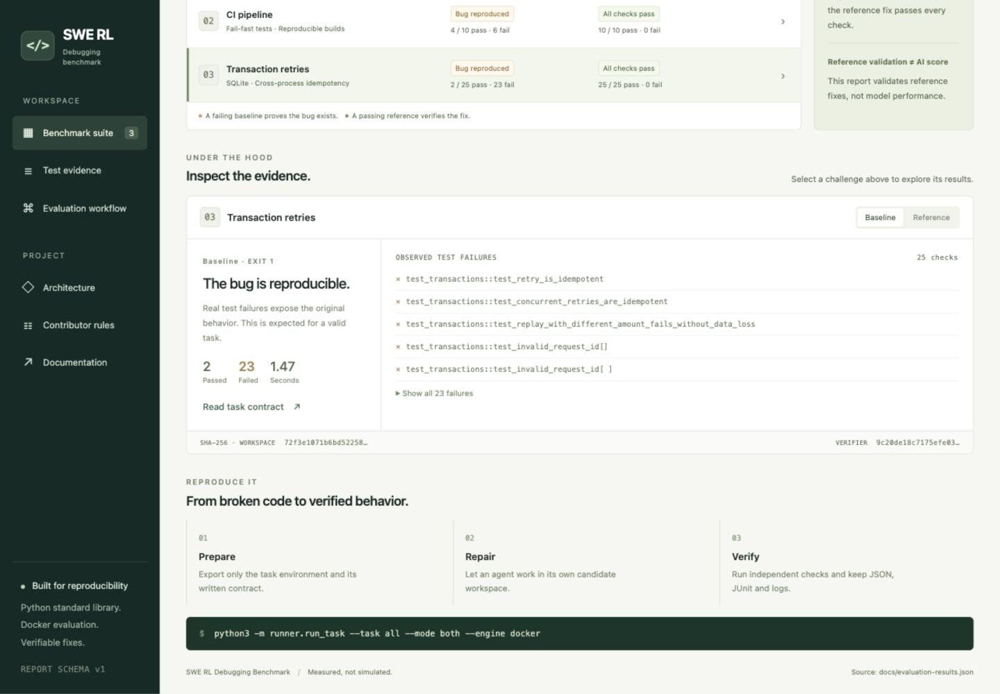
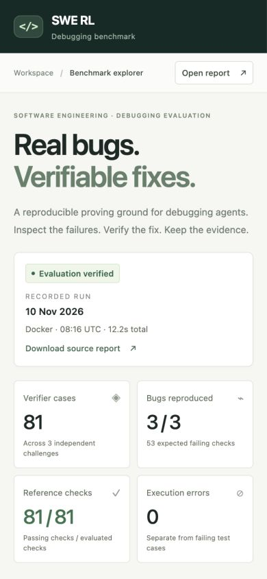

# SWE RL Debugging Benchmark

**Real bugs. Verifiable fixes.** A small, reproducible benchmark for evaluating software engineering debugging agents, with independent tests and inspectable evidence.

Three challenges cover API validation, reproducible CI builds and concurrent SQLite transactions. Each includes intentionally broken code, a written contract, external verifier tests and a reference fix. The evaluator also grades an agent's own candidate workspace.



*Actual browser capture of the included Benchmark Explorer, reading [this measured report](docs/evaluation-results.json). Reference results validate the authored tasks; they are not an AI-model score.*

[Quick start](#quick-start) · [Interactive demo](#explore-the-demo) · [Measured results](docs/evaluation-results.md) · [Architecture](docs/architecture.md) · [Contributor rules](rules/README.md)

## What this project does

1. Prove that the original code fails real behavioral checks.
2. Prove that a reference fix passes the same checks.
3. Export a clean workspace for an agent, then evaluate its submitted changes.
4. Preserve JSON results, JUnit evidence, failure names, timings and input fingerprints.

This is an **evaluation toolkit**, not an RL training pipeline or a production banking application. No AI model has been evaluated in the published reference run.

## Challenges

| ID | Challenge | Required repair | Verifier cases |
|---|---|---|---:|
| `01` | Banking API | HTTP status codes, financial validation and Decimal arithmetic | 46 |
| `02` | Broken CI pipeline | Enforced tests, compile checks and deterministic SHA-256 build manifest | 10 |
| `03` | Duplicate transactions | SQLite-enforced idempotency across threads, processes and retries | 25 |

The bugs in `tasks/*/environment/` are intentional. Maintain reference fixes in `solution/files/`; solve tasks in separately exported candidate workspaces.

## Quick start

Requirements: **Python 3.9+** on the orchestrating machine, a running Docker engine, and macOS or Linux. Containers use pinned Python 3.12. Internet is needed for initial image/package downloads; verification runs without network access.

From the repository root:

```bash
python3 -m unittest discover -s tests -v
python3 -m runner.run_task --task all --mode both --engine docker
```

Expected validation verdict:

```text
BENCHMARK VALIDATION: PASS
```

`PASS` means every baseline has genuine failing tests and every reference passes all checks. A failing baseline is the expected result.

Run one challenge with a named output directory:

```bash
python3 -m runner.run_task --task 01 --mode both --output-dir artifacts/demo-01
```

Use a new output directory for every run. Existing directories are rejected to protect previous evidence.

## Explore the demo

The included report viewer works without a frontend framework, build step, package installation or external assets:

```bash
python3 -m http.server 8000 --bind 127.0.0.1
```

Open [Benchmark Explorer](http://127.0.0.1:8000/docs/demo/) in your browser. It reads the published JSON report, lets you select challenges and evaluation modes, and shows actual failed test names and content fingerprints. Use **Open report** to inspect a fresh `report.json` locally; the file stays in your browser.

The viewer displays a **recorded evaluation**, not a live job. Running the CLI produces new evidence; opening the viewer does not execute candidate code. See the [demo and screenshot guide](docs/demo/README.md) for capture provenance and refresh instructions.

<details>
<summary>More real screenshots: evidence and mobile layout</summary>





</details>

## Evaluate an agent's fix

### 1. Export a clean workspace

```bash
python3 -m runner.run_task --task 01 --prepare /tmp/banking-candidate
```

The export contains the broken source, task instruction and evaluator-owned build/dependency inputs. Challenge 02 also includes its public unit tests. Reference fixes and external verifier tests are excluded.

Give the solving agent access only to this exported directory. The full repository contains public solutions and verifier code; exposing it would contaminate evaluation.

### 2. Let the agent repair the workspace

The agent reads `instruction.md` and edits the task source. Dockerfile and `requirements.txt` are evaluator-owned and replaced with canonical versions at grading time. This benchmark does not let submissions choose their runtime or dependencies.

### 3. Grade the complete workspace

```bash
python3 -m runner.run_task --task 01 \
  --candidate /tmp/banking-candidate \
  --output-dir artifacts/candidate-01
```

`--candidate` selects candidate mode automatically; `--mode candidate` is also supported. Submit the complete workspace, not an individual file or patch. Evaluate one task per candidate run. The evaluator copies the submission to a temporary directory, preserving its source.

## Reports and exit codes

```text
artifacts/<run>/
  report.json
  01-baseline/
    run.log
    junit.xml
  01-golden/
    run.log
    junit.xml
```

| Exit code | Meaning |
|---:|---|
| `0` | Every result matches its mode's expectation; candidate checks all pass |
| `1` | Evaluation completed but an expectation failed: baseline passed unexpectedly, or reference/candidate tests failed |
| `2` | Invalid execution or configuration: build/dependency failure, timeout, collection/setup error, skip, missing evidence or invalid arguments |

`status` records the test outcome (`passed`, `failed`, `error`). `verified` records whether that outcome matches the evaluation mode. A baseline with `status: failed` and `verified: true` is valid.

Reports include test totals, failures/errors/skips, failed test names, verifier exit codes, elapsed/build time, workspace/verifier SHA-256 fingerprints and relative evidence paths. JUnit may be absent if execution failed before pytest wrote it. Argument validation errors happen before evaluation and do not create a report.

## Execution options

```bash
python3 -m runner.run_task --help
python3 -m runner.run_task --task 03 --mode golden
python3 -m runner.run_task --task all --timeout 180 --build-timeout 600
```

- Verifier timeout: 120 seconds per mode by default, including container startup.
- Build timeout: 600 seconds per mode by default.
- Container limits: no network, 512 MiB RAM, 1 CPU, 128 PIDs and a 64 MiB `/tmp`; capabilities dropped and privilege escalation disabled.
- Timeout/interruption kills the subprocess group; Docker evaluation also removes its own container and image. Base image and build cache are retained.
- Container/image names are unique; concurrent runs must use separate output directories.

**Run local mode only on code you trust. It executes with your user permissions.** Docker configuration here is a controlled demo, not a hardened boundary for hostile code; see [execution boundaries](docs/architecture.md#execution-boundaries).

For local development, use Python **3.12+**:

```bash
python3.12 -m venv .venv
source .venv/bin/activate
python -m pip install -r requirements.txt
python -m runner.run_task --task all --mode both --engine local
```

## Architecture

```text
runner/
  run_task.py         CLI, orchestration and report publication
  workspace.py        Task registry, workspace copies and fingerprints
  execution.py        Docker/local processes, timeouts and cleanup
  verification.py     Pytest/JUnit verdict interpretation
  __init__.py

tasks/<id>/
  instruction.md      Agent-facing behavioral contract
  environment/        Intentionally broken source and runtime definition
  tests/              External verifier tests
  solution/files/     Reference replacement files

docs/
  demo/               Static report explorer; native HTML, CSS and JavaScript
  images/             Actual browser screenshots
  evaluation-results.json
  evaluation-results.md
  architecture.md

rules/                Canonical maintenance rules for humans and AI tools
tests/                Evaluator regressions and demo report checks
AGENTS.md             Cross-tool contributor entry point
CONTRIBUTING.md       Task-authoring and maintenance workflow
```

The architecture uses small functions and explicit module boundaries, without a service framework or speculative layers. [Architecture documentation](docs/architecture.md) explains ownership, import direction, scoring and trust boundaries.

## Working with humans and AI tools

Start with [AGENTS.md](AGENTS.md), then the [canonical rules](rules/README.md). Shared guidance covers architecture, benchmark integrity, development and verification. Thin adapters are provided for Cursor, Claude Code and GitHub Copilot. Other tools should be given `AGENTS.md` explicitly; automatic discovery varies by tool.

All project documentation, source comments, rules and UI copy are in English. To run all fast checks, use Python 3.9+ and Node.js 18+:

```bash
python3 -m unittest discover -s tests -v
node tests/test_demo.mjs
```

[CONTRIBUTING.md](CONTRIBUTING.md) explains how to add challenges, update dependencies and refresh published evidence. GitHub Actions runs fast checks before a three-task Docker matrix and retains execution artifacts for 14 days.

## Measured results and limits

The [published run](docs/evaluation-results.md) records **81/81 reference checks passing**, with genuine baseline failures in all three tasks. Screenshots and displayed metrics come from recorded evidence.

Three tasks cannot establish general model quality. No pass@k measurements, model traces, reward trainer, private evaluation service or hostile-code certification are included. Actual agent evaluation needs model/version, prompts, budgets, submissions and repeated trials on a larger task set.
