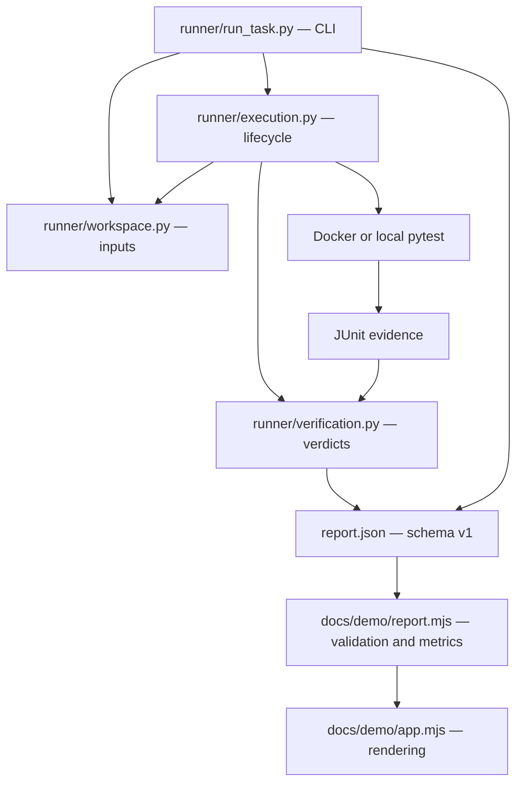

# Architecture

The project has two entry points: a Python evaluator and a static report viewer. Both share the versioned JSON report contract; the viewer does not execute code or influence scoring.

## Module boundaries

| Module | Owns | Must not own |
|---|---|---|
| `runner/run_task.py` | Argument validation, preparing exports, run orchestration, final report publication | Test assertions or process cleanup details |
| `runner/workspace.py` | Task registry, clean copies, dependency/build injection, content fingerprints | CLI output or scoring |
| `runner/execution.py` | One evaluation, subprocesses, Docker/local commands, timeouts, cleanup | Argument parsing or UI |
| `runner/verification.py` | Pytest/JUnit interpretation and mode-specific verdicts | Process execution or workspace mutation |
| `docs/demo/report.mjs` | Report boundary validation, grouping, derived metrics | DOM, network or evaluation execution |
| `docs/demo/app.mjs` | Loading reports, user selection and safe DOM rendering | Changing report data or running candidate code |
| `index.html`, `styles.css` | Semantic markup, layout, focus and responsive behavior | Scoring semantics |

Imports flow downward from CLI to execution to workspace/verification. Task fixtures never import the evaluator. Plain functions are sufficient; there are no service containers, interfaces or generic framework layers.

## Task ownership

| Component | Purpose | Task-solving agent access |
|---|---|---|
| `instruction.md` | Behavioral contract and scope | Included in export |
| `environment/` | Broken source | Editable exported copy |
| Public tests inside task 02 | Sample package's unit tests | Included; must remain meaningful |
| `tasks/<id>/tests/` | Independent verifier | Excluded from export; read-only mount during verification |
| `solution/files/` | Reference replacement files | Never included in candidate export |
| Dockerfile and `requirements.txt` | Evaluator-owned runtime inputs | Included for inspection; canonical versions restored when grading |
| `rules/`, `AGENTS.md` | Maintainer guidance | Not part of candidate export |

## Evaluation lifecycle

1. Validate task/mode, paths and timeouts; reject existing output directories.
2. Copy the broken environment or full candidate workspace to a temporary directory. Omit Git metadata, environments, bytecode, caches and build outputs. Reject symbolic links without following them.
3. Inject canonical dependency/build inputs. In golden mode, overlay reference replacement files, including hidden paths.
4. Fingerprint relative paths and file contents. Timestamps and file permissions are not included.
5. Build using a digest-pinned Python 3.12 image and version-pinned dependencies. Reuse dependency layers where available.
6. Run pytest against `/verifier` with a read-only verifier mount and a separate report mount. Disable auto-loaded plugins, candidate pytest configuration, bytecode and pytest cache.
7. Combine pytest exit status with JUnit evidence. Reject collection/setup errors, skips, empty/inconsistent reports and timeouts as invalid evaluations.
8. Remove temporary workspace and run-specific container/image. Keep logs, JUnit, JSON and build cache. Publish `report.json`.

Container/image names use UUIDs. Concurrent runs require distinct output directories. CLI flags and schema v1 remain the compatibility boundary across internal refactors.

## Scoring

| Verifier outcome | Baseline | Golden / candidate |
|---|---|---|
| Exit 0, nonempty tests, no failure/error/skip | Expectation failed | Verified |
| Exit 1, genuine testcase failures, no error/skip | Verified | Expectation failed |
| Other exit, missing/inconsistent evidence, collection/setup error, skip or timeout | Execution error | Execution error |

Exceptions during a testcase are pytest failures and may expose a real task bug. Collection/setup errors are separate because they may indicate an invalid environment. A task passes its contract as a whole; raw passing-test counts are diagnostic, not comparable difficulty scores.

`--mode both` validates authored tasks and references. `--candidate` evaluates submitted repairs. Neither runs an AI model or a reinforcement-learning loop.

## Report viewer

The static viewer fetches `docs/evaluation-results.json` when served over HTTP. A native file picker can open another report locally; imported files are not sent to a server. Files are limited to 2 MiB and checked for schema, known modes/statuses, safe counts, consistent verdicts and fingerprints before rendering.

Report strings are rendered with `textContent`. Metrics come from actual report entries. Baseline and reference checks are not double-counted when displaying unique verifier cases. Missing modes and execution errors remain visible rather than being converted into success.

The viewer can be served by Python's HTTP server or any static host. It has no backend, bundler, framework, external font or analytics dependency. Root [AGENTS.md](../AGENTS.md) and [rules](../rules/README.md) describe maintenance conventions for humans and AI tools.

## Reproducibility

Each mode starts from a clean copy. Dependency versions include transitive packages; base images are pinned by digest. Verification has no network. Task 02 checks byte-identical manifests and content-dependent hashes. Reports preserve failure names, exit status, hashes and timing.

This is not a fully hermetic build: package download still depends on registries/network, individual wheel hashes are not pinned, and host/architecture/runtime can affect timing. Workspace hashes identify recorded inputs; they do not prove integrity against adversarial code.

## Execution boundaries

**This Docker setup is not a hardened sandbox for hostile code.** It disables network at verification time, limits CPU/RAM/PIDs/tmpfs, drops capabilities and disables privilege escalation. However, candidate code runs in the pytest process, can read mounted verifier code and can write the report mount. It may tamper with the runner or reports. Image builds have network access and I/O quotas are incomplete.

Use this setup with controlled code. Untrusted agents require a separate worker/VM, minimal filesystem, externally owned private verification, authenticated reports and stronger aggregate resource limits. Never expose the full solution repository to a solving agent. Local execution has no container isolation.

## Growth path

Add tasks using [CONTRIBUTING.md](../CONTRIBUTING.md). Actual model evaluation should record prompts, model/version, budgets, submissions and repeated trials before reporting pass@k. RL training needs a separate reward/training loop and held-out evaluation set. Add those components when that scope is requested, not as speculative infrastructure.
